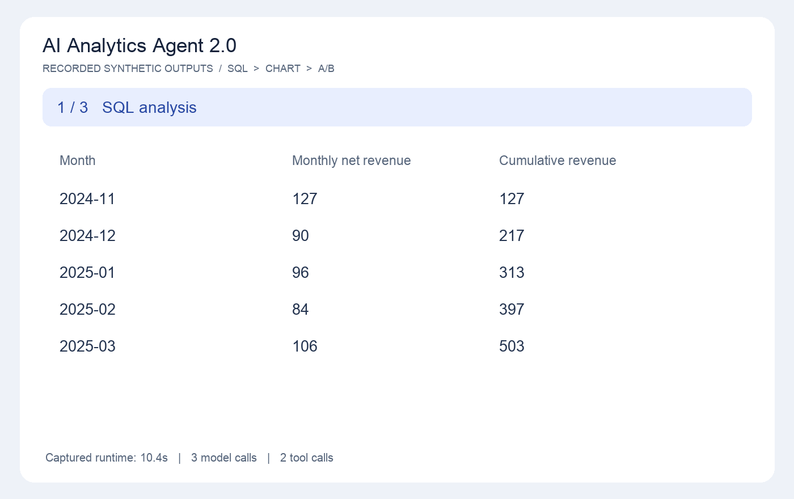
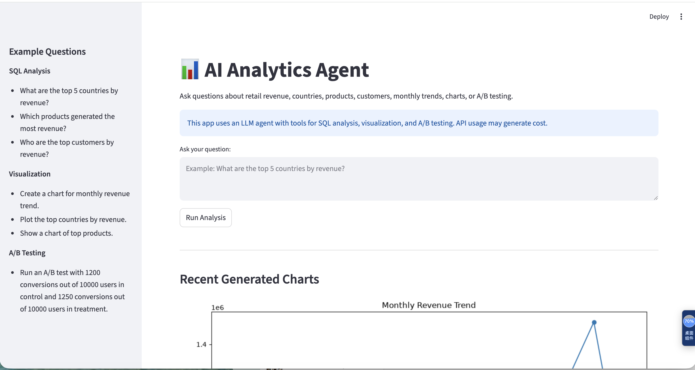
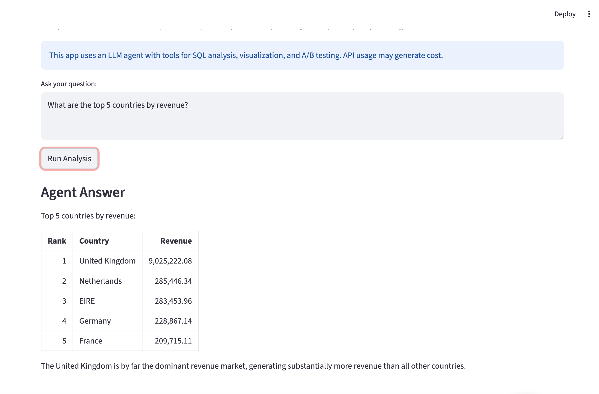
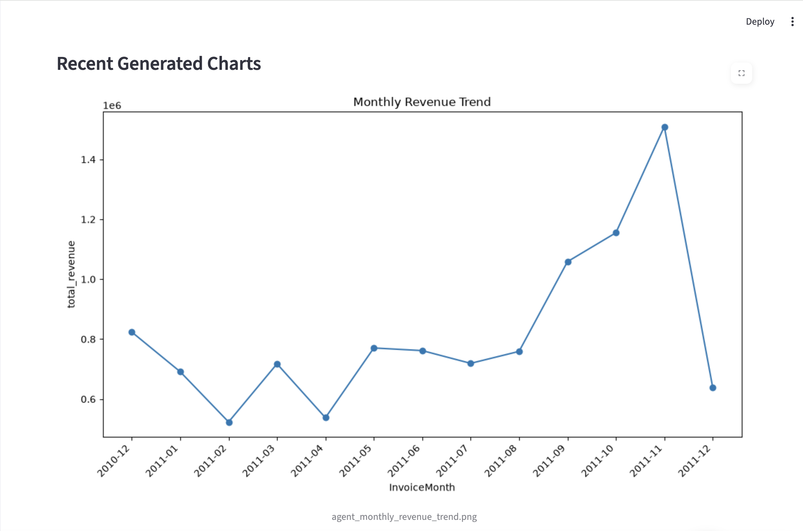
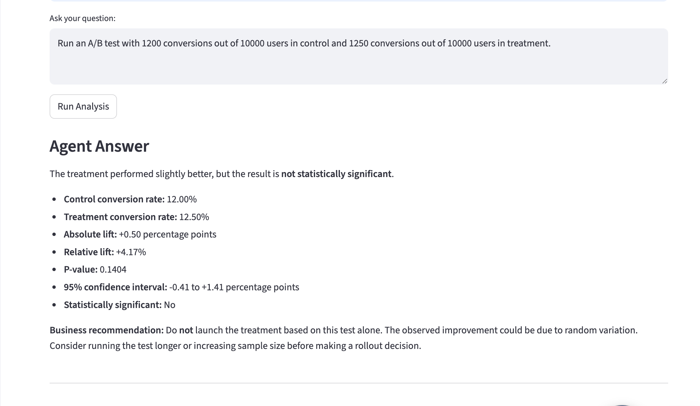

# AI Analytics Agent 2.0

Ask a question, run read-only analytics tools, and receive an answer whose
numerical claims come from verified evidence. The project supports SQL analysis,
revenue charts, and validated A/B testing through Streamlit and FastAPI.



The preview replays actual archived outputs; it is not a screen recording or a
live session. [Demo details](docs/acceptance.md) · [Architecture](docs/architecture.md).

Phase 4 adds a FastAPI entry point, isolated requests, bounded concurrency,
controlled chart downloads, a pinned Docker image and dependency lock, and CI.
The original Streamlit app remains available. Phase 3 adds per-invocation metrics, optional payload-free LangSmith traces,
and reproducible local LangSmith evaluation of the frozen synthetic tasks.
LangSmith cloud tracing and the 12-case recorded-result experiment were verified
on 2026-10-18 after correcting the locally saved value of the original key.
Phase 2 provides layered read-only SQL enforcement, validated A/B testing with
sparse-data handling, contained unique chart files, and evidence-based numeric
answer rendering. The LangGraph workflow retains bounded recovery, conversation
checkpoints and the SQL, visualization, A/B testing tools and Streamlit UI.
A shared Responses API client preserves the configured model.

See the [Phase 0 baseline](docs/phase0_baseline.md),
[Phase 1 workflow](docs/phase1_workflow.md),
[Phase 2 reliability](docs/phase2_reliability.md), and
[Phase 3 evaluation and observability](docs/phase3_observability.md), and
[Phase 4 API, Docker and CI](docs/phase4_engineering.md).
Phase 3 checks passed 69/69 offline tests, 34/34 frozen tool checks, and 12/12
synthetic tasks with deterministic checks and Codex answer review in one replay. These are bounded checks,
not a production accuracy guarantee or proof of free-text semantics.

Phase 4 passes 87/87 offline tests in the project environment and Linux container,
34/34 tool checks, and three real-model API checks using synthetic SQL, chart and
A/B tasks. The API and Streamlit containers both pass their health checks.
The cloud connection follow-up passes 90/90 local offline tests, including
bounded readback retries and idempotent synchronization of hosted dataset metadata.
See the [cloud connection record](eval/results/phase3_cloud_connection.json) and
[verified cloud evaluation](eval/results/phase3_cloud_evaluation.json).

New-scenario acceptance passed **19 scenarios / 25 turns** on a separate
24-transaction synthetic fixture, including complex SQL, conversation follow-ups,
invalid inputs, injected tool failures and checkpoint resume. All turns passed
deterministic checks plus a separate Codex answer review; this is development
acceptance, not an independent external benchmark. The original 12-task suite
remains unchanged. See the [coverage, limits and reproduction steps](docs/acceptance.md).
The complete local offline suite now passes **96/96 tests**.
GitHub Actions also passed the Python checks and Docker smoke checks on
2026-10-18: [verified run](https://github.com/mirrorcsy0909-tech/ai-analytics-agent/actions/runs/39103061043).
The complete upgrade is available for review in [draft PR #1](https://github.com/mirrorcsy0909-tech/ai-analytics-agent/pull/1).

## Run locally

Use Python 3.13 (tested with 3.13.7), install `requirements.txt` in a virtual
environment, and configure your own `.env` from `.env.example`. Keep credentials
out of version control. `OPENAI_MODEL` is preserved; optional
`OPENAI_REASONING_EFFORT` defaults to `medium`.

```bash
python3 -m venv .venv
source .venv/bin/activate
python -m pip install --require-hashes -r requirements.lock
python -m streamlit run app/streamlit_app.py
```

The retail database must already be available at `database/analytics.db` for
retail queries. The synthetic offline tests do not require that database or an
API key:

```bash
python3 -m unittest discover -s tests -v
```

Recheck the new archived acceptance without model calls or network access:

```bash
python3 eval/acceptance_score.py \
  --report eval/results/acceptance_v1_first_run.json \
  --reviews eval/results/acceptance_v1_reviews.json
```

To replay the frozen synthetic tasks with real model calls (the legacy option
uses the current tools with the original architecture, not archived old code):

```bash
python3 eval/phase0_agent_baseline.py --run --implementation legacy
python3 eval/phase0_agent_baseline.py --run --implementation workflow
```

Review tool observations and final answers before assigning success scores.
See the Phase 2 report for the archived comparison, exact scope, latency and
token usage. The stronger answer protocol increases observed runtime and usage.

Score an archived recording locally with LangSmith, without model calls or upload:

```bash
python3 eval/phase3_evaluate.py --report eval/results/phase3_agent_workflow.json
```

New live replays can add `--observe` to record local callback metrics. Streamlit
and the CLI record each invocation under `outputs/telemetry/`; resume calls count
only newly executed work. Remote tracing defaults to off. Configure the optional
settings in `.env.example` locally and follow the Phase 3 guide to enable tracing
or explicitly publish a synthetic recorded-result experiment.

## API and Docker

```bash
python -m uvicorn api.main:app --host 127.0.0.1 --port 8000 --workers 1
```

Open `http://127.0.0.1:8000/docs` for the request schema. Submit independent
questions to `POST /v1/analyses`; responses include status, answer, metrics and
bounded chart links. See the Phase 4 guide for authentication, limits and errors.

```bash
docker compose build
python3 scripts/load_docker_database.py
docker compose --profile ui up -d
```

The database loader copies a consistent snapshot into a local Docker data volume;
it does not modify the source or send it to a cloud service. Containers mount the
database read-only and receive credentials only at runtime. GitHub Actions are
configured but have not run remotely because these changes have not been pushed.

## Project Overview

This project is an AI-powered analytics agent that allows users to ask natural-language questions about business data. The agent can query a SQLite database, generate visualizations, run A/B testing analysis, and summarize results into business insights.

The goal of this project is to demonstrate how large language models can be connected with data analysis tools to support self-service analytics for non-technical users.

---

## Features

- Natural-language analytics interface
- SQL-based retail revenue analysis
- Automated chart generation
- A/B testing evaluation
- Business insight generation
- Streamlit web application

---

## Tech Stack

- Python
- pandas
- SQLite
- matplotlib
- statsmodels
- LangChain
- OpenAI API
- Streamlit

---

## Project Structure

```text
AI-analytics-agent/
├── agent/
│   ├── analytics_agent.py
│   ├── answer_validation.py
│   ├── evidence.py
│   ├── model_config.py
│   ├── observability.py
│   └── workflow.py
├── app/
│   ├── basic_analytics_assistant.py
│   └── streamlit_app.py
├── scripts/
│   └── create_database.py
├── tools/
│   ├── sql_tool.py
│   ├── visualization_tool.py
│   └── ab_test_tool.py
├── screenshots/
├── requirements.txt
├── .env.example
├── .gitignore
└── README.md
```

Core Capabilities

1. SQL Analytics

The agent can answer questions such as:

- What are the top 5 countries by revenue?
- Which products generated the most revenue?
- Who are the top customers by revenue?

The SQL tool only allows safe SELECT queries to prevent accidental modification of the database.

⸻

2. Visualization

The agent can generate charts for common business analyses, including:

- Monthly revenue trend
- Top countries by revenue
- Top products by revenue
- Top customers by revenue

Generated charts are saved locally in the outputs/ folder.

⸻

3. A/B Testing

The A/B testing tool validates conversion counts and compares independent groups
using a two-proportion z-test or Fisher exact test for sparse counts. It labels
the test direction, interval method and assumptions; relative lift is undefined
when the control rate is zero.

It returns:

- Control conversion rate
- Treatment conversion rate
- Absolute lift
- Relative lift
- Z-statistic
- P-value
- 95% confidence interval
- Business recommendation

Dashboard Preview

The Streamlit web application provides a simple interface for users to ask natural-language analytics questions and receive AI-generated answers, SQL-based results, visualizations, and A/B testing recommendations.

Streamlit App Interface

The main interface allows users to enter business questions and run analysis through the AI Analytics Agent. Example questions are provided in the sidebar to demonstrate SQL analysis, visualization, and A/B testing capabilities.

⸻

SQL Analysis Result

The agent can answer revenue-related business questions by generating and executing safe SQL queries against the SQLite retail database. The result is summarized into clear business insights for decision-making.

⸻

Monthly Revenue Visualization

The visualization tool generates charts automatically based on user requests. For example, the monthly revenue trend chart helps identify seasonal sales patterns and peak revenue periods.

⸻

A/B Testing Result

The A/B testing tool evaluates experiment performance by calculating conversion rates, lift, p-value, confidence interval, statistical significance, and a business recommendation.

## Dashboard Preview

### Streamlit App Interface



### SQL Analysis Result



### Monthly Revenue Visualization



### A/B Testing Result



## Evaluation Harness

This project includes a lightweight evaluation harness to test the core analytics tools without calling the OpenAI API.

The harness checks:

- SQL query execution
- SQL safety validation for read-only SELECT queries
- Automated chart generation
- A/B testing output structure and statistical results

To run the evaluation harness:

```bash
python3 eval/phase0_baseline.py
```

Business Value

This project shows how AI agents can help automate routine analytics workflows. Instead of manually writing SQL, creating charts, and interpreting results, users can ask questions in natural language and receive data-driven answers with business context.

Potential use cases include:

- Self-service business intelligence
- Revenue monitoring
- Customer segmentation
- Experiment analysis
- KPI reporting automation

⸻

Notes

The raw dataset, generated SQLite database, API keys, and output charts are not included in this repository for file size and security reasons.
