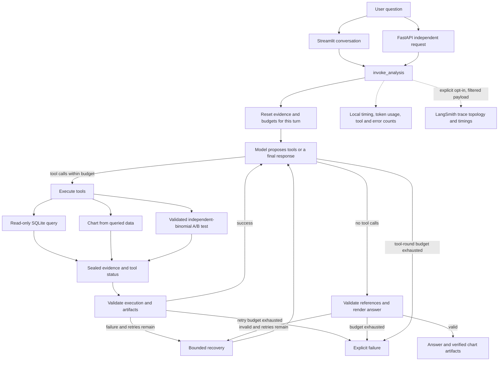

# Architecture

The application uses one model and an explicit LangGraph workflow. SQL, charts,
and A/B testing remain ordinary tools. The model proposes calls; Python executes
them, validates evidence, and renders supported numerical claims.

## State and boundaries

- Streamlit keeps conversation checkpoints in process memory. A later question
  retains messages but resets evidence, artifacts, validation, and retry budgets.
  A resume continues the interrupted checkpoint. Restarting the process loses
  those conversations.
- FastAPI assigns each request its own identity and conversation. Its chart
  download registry is bounded, expires entries, and checks file hashes.
- The SQL layer combines a parsed query policy with SQLite read-only mode,
  an authorizer, a row cap, and an execution time budget. It does not execute
  arbitrary Python or give the model shell access.
- Chart evidence contains the same displayed rows used in the answer protocol.
  Artifacts stay inside the configured output directory.
- A/B tests validate integer counts, preserve the requested hypothesis, and use
  a sparse-data method when appropriate. Results do not establish randomization
  or a causal effect on their own.
- Final numerical claims are references to successful evidence. This catches
  unsupported values and declared statistical conclusions; it does not prove
  all prose, SQL intent, or business interpretation correct.

## Observability and evaluation

Normal analyses collect local metrics. Optional cloud tracing strips prompts,
SQL, result rows, answers, detailed errors, and serialized arguments before
upload. A cloud outage leaves the analysis available. Local submission status
and independently verified cloud persistence are separate facts.

The original twelve-task regression suite remains unchanged. The new acceptance
suite uses a different synthetic fixture, multi-turn scenarios, and injected
failures. References are frozen before a live run; narrative reviews are stored
separately with an answer hash. Fixing a discovered failure requires a new result
file instead of overwriting the first run.

## Runtime

The local UI and API share the same workflow and tools. Docker uses locked
dependencies, a non-root user, a read-only database volume, and a separate output
volume. CI runs offline tests and a container smoke check without API credentials
or the private retail database. There is no public hosting, distributed job
queue, persistent multi-user state, or automatic production deployment.
