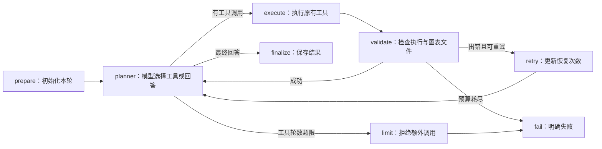

# Phase 1：模型兼容性、显式状态与受控执行

后续进展：Phase 2 已完成，工具基线 34/34、离线测试 50/50、固定任务本次严格审阅 12/12。见 [Phase 2 报告](phase2_reliability.md)。下文保留 Phase 1 当时的实现与结果。

完成日期：2026-10-17（America/New_York）。SQL、Visualization、A/B Testing 和 Streamlit 均保留。沿用五阶段规划，当前交付接口修复和 Phase 1，不把 Phase 2 的统计、SQL、答案语义验证提前宣称为完成。

## 已完成

1. **修复模型接口。** `agent/model_config.py` 统一创建 `ChatOpenAI`，显式使用 Responses API，保留实际配置的 `gpt-5.6` 和 medium reasoning。设置请求超时 30 秒、SDK 自动重试 0 次、单次输出上限 3,000 tokens。`store=False`，通过加密 reasoning 项衔接工具调用。原先的 HTTP 400 已不再出现。依据：[OpenAI Responses 迁移文档](https://developers.openai.com/api/docs/guides/migrate-to-responses)、[Reasoning 模型指南](https://developers.openai.com/api/docs/guides/reasoning)。
2. **完成旧版对照。** `build_legacy_agent()` 保留原 `create_agent`、工具定义和原系统提示词，使用兼容的模型客户端跑完固定 12 题；原先的接口错误记录也保留。
3. **新增显式工作流。** `agent/workflow.py` 记录问题、实际工具计划、工具证据、验证事件、图表路径、重试次数、执行轨迹和最终状态。
4. **添加执行边界。** 原工具包装器返回的错误字符串与抛出的异常都会被识别。工具出错最多恢复 2 次，最多执行 6 轮工具；超过预算明确失败，补齐工具响应以保持后续会话记录合法。
5. **接入会话与恢复。** Streamlit 和 CLI 使用 `InMemorySaver` 与独立会话 ID。模型调用中断后，页面提供恢复按钮；已完成工具之后的模型中断可从检查点继续，不必重复那一轮已完成的工具。
6. **修复图表显示。** 页面直接显示当前分析状态中的 `artifacts`，替代前后文件名集合比较；重复生成同名图也能显示。

## 结构与执行流程



这是同一个模型驱动的工作流。`plan` 保存模型实际提出的工具名称与参数，不额外引入 Planner Agent、Executor Agent 或 Validator Agent，也不记录模型的隐藏思维链。

| 状态字段 | 用途 |
| --- | --- |
| `messages` | 会话消息与工具响应；有检查点时跨轮保留 |
| `question` / `plan` | 当前问题与实际工具调用计划 |
| `tool_results` | 每次工具调用的参数、输出、状态与轮次 |
| `validation` | 执行检查、预算检查、是否有工具证据 |
| `artifacts` | 当前分析生成的图表文件路径 |
| `retry_count` / `tool_rounds` | 当前问题的恢复次数与工具轮数 |
| `status` / `final_answer` / `trace` | 执行结果、最终回答与节点轨迹 |

新问题保留会话消息，但会重置本轮的计划、证据、图表和预算，避免把上一个问题的结果计为本轮证据。`responded` 表示无工具的文字回复，例如澄清或拒绝；`completed` 表示工具执行与回复流程结束；`failed` 表示未能完成。**这些状态都不是分析准确率评分。**

默认 `build_agent()` 可继续直接 `.invoke(...)`；只有显式传入 checkpointer 时，调用方需要提供 `configurable.thread_id`。Streamlit 与 CLI 已提供。恢复中断使用同一配置调用 `agent.invoke(None, config=config)`。

## 实测结果

固定问题与合成数据未变，两个版本都使用同一个模型配置和评测脚本，每版各运行一次。

| 指标 | 接口修复后的旧版 | Phase 1 工作流 |
| --- | ---: | ---: |
| 完成调用的题目 | 12/12 | 12/12 |
| 工具行为符合要求 | 11/12 | 11/12 |
| 严格任务通过：工具 + 最终事实 | 10/12 | 9/12 |
| 平均整题耗时 | 4,765.83 ms | 4,027.44 ms |
| 全部模型轮次的总 tokens | 19,936 | 20,101 |

评分由 Codex 对照实际工具调用、数值和最终回答审阅，逐题理由与答案指纹均已记录，未调用另一个模型生成评分。

- 两版的零控制组转化率任务都因 A/B 工具除零未完成。旧版能给出文字解释，但不能替代成功的工具分析。新版将这类失败显式反映到工作流状态，并阻止将错误工具的结果当成已验证分析。
- 旧版产品答案擅自使用美元符号；新版产品和客户答案有同样问题。合成数据没有声明币种，因此严格事实评分将它们记为失败。Phase 1 的执行验证尚不能发现这种语义错误。
- 其余任务的排序、数值、图表数据、澄清和拒绝行为符合要求。

样本只有 12 个合成任务，每版仅跑一轮。不能据此判断架构使总体准确率提高或降低，也不能把本次耗时差异宣传为稳定的性能提升。

完整记录：

- [旧版原始接口错误](../eval/results/phase0_agent_baseline.json)
- [接口修复后的旧版](../eval/results/phase0_agent_responses.json)
- [Phase 1 工作流](../eval/results/phase1_agent_workflow.json)
- [逐题评分与对照](../eval/results/phase1_comparison.json)

## 验证与运行

项目根目录：

```bash
# 离线：20 项工作流、恢复、会话、模型配置与 Streamlit 操作检查
python3 -m unittest discover -s tests -v

# 启动页面，沿用本机已有 .env
python3 -m streamlit run app/streamlit_app.py

# CLI
python3 agent/analytics_agent.py

# 真实模型评测：仅使用合成数据库，有 API 调用
python3 eval/phase0_agent_baseline.py --run --implementation legacy
python3 eval/phase0_agent_baseline.py --run --implementation workflow

# 工具基线：无模型调用
python3 eval/phase0_baseline.py
```

20 项离线测试全部通过。原有工具评测继续 4/4 通过；扩展工具检查仍为 18/34 通过，16 项未满足要求与 Phase 0 相同，没有把未来的验证要求改为通过。

评测默认写入 `outputs/` 的最新结果，不覆盖冻结的 `eval/results/`。真实模型评测保存调用与证据，自动评分字段默认空；这里的冻结结果经过逐题审阅才附加评分。不要把一次调用完成当作任务通过。

## 当前边界和下一阶段

- 检查点在当前 Python 进程内有效，重启后不保留。跨进程持久化、服务部署与资源管理在后续工程化中完善。
- Phase 1 验证的是执行状态、工具响应和图表文件存在性，**没有实现 SQL 语法级安全、统计适用性或答案事实验证**。
- 图表底层仍使用固定文件名和共享 matplotlib 状态；高并发的文件冲突与绘图隔离尚未解决。
- SQLite / CSV 未重建，原始数据未进入模型评测；所有实测使用固定的合成数据。
- 原本已有的 `.gitignore` 暂存与未暂存修改保留，没有重置、提交或推送。

Phase 2 优先补齐：A/B 输入与零控制组处理、SQL 结构校验和只读连接、图表数据与输出路径校验，以及最终答案中的数值、单位和结论必须有证据支持。后续仍按 Phase 3 LangSmith、Phase 4 FastAPI / Docker / CI 推进。
